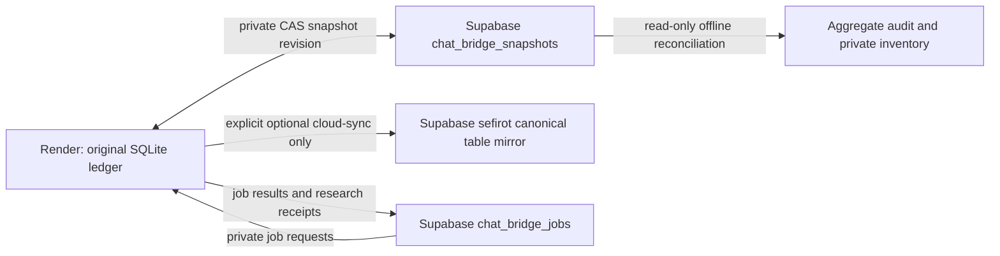

# P0-C: canonical storage and empty materialized mirror



The durable snapshot and optional normalized mirror are separate stores with
different write paths. chat_store.checkpoint saves a compressed original SQLite
blob with compare-and-swap revision. It never invokes cloud_sync.mirror.
The table mirror is populated only by its explicit dedicated-ingest operation;
empty mirror tables are not proof that the snapshot's records were lost.
Job results are another store and are not automatically inserted as predictions.

## Independent read-only observation

Supabase metadata at 15 October 14:43:24 UTC: primary snapshot revision 59,
updated 12 October 13:15:45 UTC, encoded length 656004 bytes. Stored compressed
checksum is 59844ba9e9110abec9cdb2a4e1a956aaae63ab78b48b38c33017c394cdc58a07.
A separate read-only SQL SHA-256 computation over decoded compressed bytes
matches that checksum. Seven normalized tables have zero rows: predictions,
decisions, calibrators, validation_runs, odds_snapshots, closing_odds, results.

The private local original has raw SHA-256
3ae7ad31957eebba32ef9d337a07cc335f79c95144112fb2502df42a48581ba2.
Its deterministic gzip representation with portable OS header byte 255 matches
the independently computed remote compressed checksum. Decompression preserves
the exact raw original. Python/zlib OS header byte 3 alone produces a different
compressed checksum; it is not a difference in the SQLite content.

Reused cloud_sync.snapshot validates an owned immutable copy: SQLite schema,
foreign keys, original record validation, audit links and chain. It finds
31 predictions, 27 decisions, 27 matches, 2 original odds snapshots, 62 audit
rows, zero bets/results/calibrators/validation runs/split assignments. All 31
prediction IDs are distinct and retain their original build identity. The
latest historical worker status's 31/27 counts are explained by this snapshot.
Four extra prediction records relative to fixture count are historical records,
not new predictions created by this audit. No seal/hash/fixture ID is migrated.

This proves canonical content agreement and explains the 31-versus-0 counts.
It does not prove provider-origin truth, current worker memory contents,
independent HOLDOUT or the content of any future materialized mirror. The
existing legacy fixture-ID compatibility restriction in the operator adapter
is not bypassed by this inventory. Current operator presentation and hosted
materialization are separate follow-up work.

## Reproducible read-only reconciler

scripts/storage_reconciliation.py accepts an offline SQLite snapshot and a
names/counts/checksums-only cloud observation. It has no network or production
write path, reuses the existing canonical validator, rejects sidecars/changed
source bytes and reports aggregate counts only. Its optional per-prediction
inventory contains original ID/seal/build/revision/coverage/source hash and
verified ledger witness; it is created exclusively with mode 0600 outside Git.
Provider-origin attestation remains false. Repeated review is deterministic and
cannot append a historical prediction as a new one.

The observation input has exact keys observed_at, snapshot and mirror_counts.
snapshot contains revision, checksum, actual_compressed_sha256 and updated_at.
mirror_counts contains the seven table names above. Caller-supplied metadata
is explicitly labelled CALLER_SUPPLIED_OBSERVATION; an arbitrary JSON file is
not an authenticated cloud attestation. In this stage its provenance is the
connected read-only SQL transcript. Equal mirror counts never certify content.

Example using private paths (not committed data):

```text
python scripts/storage_reconciliation.py --db PRIVATE_ORIGINAL.sqlite --cloud-observation PRIVATE_OBSERVATION.json --output PRIVATE_AGGREGATE.json --private-inventory PRIVATE_INVENTORY.json
```

No cloud materialization or migration is executed. If authorized later, reuse
the existing one-way mirror with its dedicated role, original-row equality,
atomic rollback and audit verification; do not turn synchronization into new
predictions or monetary approval. Audit/reconciler stage DONE; hosted mirror
population is deliberately pending separate authorization. PASS/stake=0.
